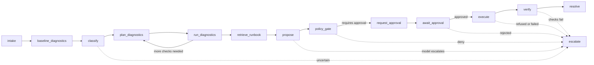

# Agentic Reliability Lab

An incident-response agent for a **synthetic** corporate IT environment. It receives a ticket,
diagnoses a real failure in running services, proposes a fix backed by evidence, and executes
it only after deterministic policy checks and a human approval. Every step is recorded in a
tamper-evident audit trail.

The design rule: **the language model proposes; deterministic code decides and acts.**

> **Status: increment 1 of the INC-001 milestone.** What works today and what does not is listed
> under [Status](#status). Nothing here connects to, or is modelled on, any real organisation's
> systems. All services, tickets, users and data are fictional.

**Stack:** Python 3.12 · LangGraph · Anthropic Claude API (structured outputs) · FastAPI ·
PostgreSQL 16 + pgvector · Docker Compose · Pydantic · pytest · GitHub Actions · uv

## What happens in INC-001

The sandbox's `app-db` PostgreSQL container is **really stopped** (`make fault-db-down`), so
`orders-api` really fails. The agent then runs this LangGraph workflow:



Every edge also routes to `escalate` if a limit is hit (steps, diagnostic rounds, tool calls,
LLM calls, tokens or cost). See [docs/architecture.md](docs/architecture.md). How the design got here, including what
the first live model run exposed, is in the [engineering journal](docs/engineering-journal.md).

## Who decides what

| Decision | Made by | Where |
| --- | --- | --- |
| Which services to check first, before any model call | Code | `baseline_diagnostics` node |
| Incident category, severity, affected service | **LLM** (proposal, given that evidence) | `classify` node |
| Which diagnostic checks to run next | **LLM** (proposal) | `plan_diagnostics` node |
| Whether a requested check is allowed, and running it | Code | `DiagnosticToolbox.run` |
| Diagnosis, proposed action and target | **LLM** (proposal) | `propose` node |
| Whether the action is allowed, denied, or needs approval | Code | `PolicyEngine.evaluate` |
| Whether the action runs | **Human** approval + code re-check | `await_approval`, `RemediationExecutor` |
| Whether the fix worked | Code | `Verifier` |
| Every route between steps, every limit | Code | `_guard` and routers in `workflow.py` |

## Safety controls

- **Read-only diagnostics.** The model can only *request* tools by name; an allowlist per
  incident category decides what runs. Unknown tools and services are refused and recorded.
- **Action catalog.** The only write operation is `restart_service`, and only for targets
  listed in [`config/actions.yaml`](config/actions.yaml). The agent's own database is a
  protected target that can never be remediated.
- **Policy outside the model.** [`config/policy.yaml`](config/policy.yaml) and
  `arl/policy/engine.py`: confidence threshold, cited evidence, protected targets, cooldown,
  and ITIL change type (a *normal* change needs approval).
- **Approval bound to one action.** The approval carries a SHA-256 hash of run, incident,
  action and target; it expires after 15 minutes, must come from a human, and is single use.
- **Defence in depth.** The executor re-runs the policy and re-validates the approval itself,
  so even a routing bug cannot execute an unapproved action.
- **No shell, no Docker socket for the agent.** Restarts go through a separate `platform-ops`
  service with a narrow API (increment 2).
- **Untrusted text stays data.** Ticket text, tool output and runbooks are passed to the model
  inside tags it is told never to obey; nothing the model writes is executed.
- **Hard limits** on graph steps, diagnostic rounds, tool calls, LLM calls, tokens and cost.
- **Audit trail.** Hash-chained events; the agent's database role can insert but not update or
  delete them.
- **No secrets in git.** Keys and passwords live in a git-ignored `.env`; CI scans for leaks.

## Quickstart (macOS with Colima)

Requires [Colima](https://github.com/abiosoft/colima) (or Docker Desktop) and
[uv](https://docs.astral.sh/uv/).

```bash
colima start
cp .env.example .env          # set your own local passwords; API key optional
uv sync
make up                       # ops-db, app-db, orders-api
make status                   # orders-api /health -> 200

make fault-db-down            # INC-001: stop app-db for real
make status                   # orders-api /health -> 503, "Connection refused"
uv run arl-demo               # run the workflow (scripted model, free)
make fault-clear              # restore app-db by hand (increment 2: the agent does this)
```

To use real Claude instead of the scripted model, put your key in `.env` and run
`ARL_LLM_BACKEND=anthropic uv run arl-demo`. Each run is capped by the limits in `.env`
(default $0.75 per run). Set a spend limit in the Anthropic Console as well.

## Tests

```bash
make test               # 61 unit and workflow tests: no Docker, no API key, no cost
make test-integration   # real outage + database permission tests (needs `make up`)
make lint               # ruff, including bandit security rules
```

Routine tests use `ScriptedLLM` with an evidence-aware stand-in (`arl/llm/stand_in.py`) that
only concludes what the evidence it receives supports, so CI is free and repeatable without
assuming hindsight. Evaluation cases, including the original symptom-only ticket, live in
[`evals/cases.yaml`](evals/cases.yaml); run one with `uv run arl-demo --case <id>`. They prove, among other things, that a rejected approval, an approval for a
different action, a self-approval, an expired or reused approval, an invented action, and a
protected target **never reach the platform**. A separate evaluation suite against real
Claude comes in a later increment.

## Status

| Area | State |
| --- | --- |
| Sandbox: app-db, orders-api, ops-db, real fault injection | Implemented |
| LangGraph workflow with approval interrupt and escalation paths | Implemented |
| Read-only diagnostics: service health, TCP | Implemented |
| Baseline checks before classification, scoped by configuration item and dependencies | Implemented, tested with the stand-in model; live Claude re-test pending |
| Redacted model-output debugging (`arl-demo --show-model-output`) | Implemented |
| Policy engine, approval binding, executor re-checks, verifier | Implemented |
| Audit trail: in-memory and Postgres (append-only role) | Implemented |
| LLM budget: calls, tokens, cost per run | Implemented |
| Claude backend (`ClaudeLLM`) | Implemented, not yet exercised by an eval suite |
| `platform-ops` restart service | Next increment; today an approved restart fails safely and escalates |
| ITSM ticket service, Postgres checkpointer, log collection | Next increments |
| pgvector retrieval (today: keyword retrieval over runbooks) | Planned |
| AI evaluation suite, web UI, INC-002 to INC-005 | Planned |

## Project layout

```
config/            service catalog, action catalog, policy (YAML)
db/                ops-db and app-db schemas, least-privilege roles
docs/              architecture, decision records, engineering journal, runbooks
evals/             evaluation cases (synthetic tickets and expected outcomes)
src/arl/
  graph/           LangGraph state, workflow, checkpointing
  llm/             LLM interface, scripted model, Claude client
  policy/          policy engine, approvals
  tools/           service/action catalogs, probes, diagnostic toolbox
  prompts/         versioned system prompts
  remediation.py   executor and verifier
  audit.py         hash-chained audit trail
  sim/             synthetic services (orders-api)
tests/             unit, workflow and integration tests
```

## Related work

The run-log, evidence-capture, retry and test-database patterns come from my earlier
[University Integration Lab](https://github.com/minimascientific/university-integration-lab).

## License

MIT
