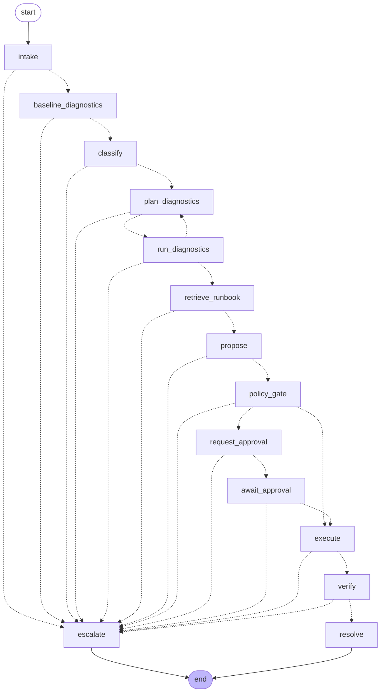

# Architecture

## Purpose

Show how an LLM-based agent can handle a recurring IT incident end to end **within explicit
boundaries**: it can look, reason and propose, but only deterministic code and a human can
let it change anything.

## Components

| Component | Responsibility | Trust |
| --- | --- | --- |
| LangGraph workflow (`arl/graph`) | Orders the steps, routes between them, pauses for approval | Deterministic |
| LLM client (`arl/llm`) | Returns typed proposals: classification, diagnostic plan, remediation | Untrusted output |
| Diagnostic toolbox (`arl/tools`) | Runs allowlisted read-only checks against the sandbox | Deterministic, read-only |
| Baseline scope (`arl/tools/baseline.py`) | Chooses first checks from the ticket's configuration item and catalog dependencies | Deterministic, read-only |
| Runbook retriever (`arl/knowledge.py`) | Finds relevant runbooks for the model to cite | Deterministic |
| Policy engine (`arl/policy/engine.py`) | Allow, deny, or require approval, with reason codes | Deterministic |
| Approvals (`arl/policy/approvals.py`) | Bind a human decision to one action, target and incident | Deterministic |
| Executor and verifier (`arl/remediation.py`) | Re-check, act through platform-ops, measure the result | Deterministic |
| platform-ops (`arl/services/platform_ops.py`) | One restart endpoint: token, own target allowlist, idempotency, rate limit | Deterministic, separate process |
| docker-proxy (socket proxy) | Forwards only container stop/restart/kill to Docker | Off-the-shelf, internal network only |
| Audit log (`arl/audit.py`) | Append-only, hash-chained record of every step | Deterministic |
| Sandbox (`docker-compose.yml`) | `app-db`, `orders-api`, `ops-db`, `platform-ops`, `docker-proxy` | Synthetic |

`ops-db` (the agent's records) is separate from `app-db` (the thing that breaks), so a broken
application database never takes the audit trail or checkpoints with it.

## The LangGraph workflow

Generated from the compiled graph (`graph.get_graph().draw_mermaid()`); dotted lines are
conditional edges.



### LangGraph concepts as used here

- **State** (`graph/state.py`): one `TypedDict` passed between nodes. Nodes return only the
  keys they change. `evidence` is appended (reducer `operator.add`); `usage` and `steps` are
  summed; everything else is replaced.
- **Nodes** (`graph/workflow.py`): plain Python functions `state -> partial update`. Three of
  them call the model; the rest are deterministic.
- **Edges and conditional routing:** every edge out of a node is conditional and wrapped in
  `_guard`, which sends the run to `escalate` if any node recorded an escalation or the step
  limit is reached. Only then does the node-specific router run (for example
  `after_policy_gate` maps `allow` / `requires_approval` / `deny`).
- **Evidence before classification:** `baseline_diagnostics` runs before the first model call.
  Code chooses the services (the ticket's configuration item and its `depends_on` chain, or
  the catalog's user-facing services when the ticket names none), bounded by depth, service
  count and `max_tool_calls`. See [ADR 0005](adr/0005-baseline-diagnostics-before-classification.md).
- **Tool calling:** the model does not call tools directly. It returns a typed
  `DiagnosticPlan` naming tools; `run_diagnostics` enforces the allowlist and executes them.
  This keeps execution in our code, where it can be limited and audited.
- **Checkpointing** (`graph/checkpointing.py`): state is saved after each node, keyed by
  `thread_id` (our `run_id`). Deserialisation is limited to an allowlist of our own types.
- **Human in the loop:** `await_approval` calls `interrupt()`. The graph stops and saves
  state; the caller resumes it with `Command(resume=<decision>)`. On resume the node re-runs
  from its first line, so it has no side effects before `interrupt()`; the approval request
  is created in the previous node for that reason.

## Approval binding

```
action_hash = sha256(canonical_json({run_id, incident, action_id, target}))
```

The approver sees the hash; the decision must carry it back. The executor recomputes it from
what is about to run and refuses on mismatch, expiry, a non-human approver, or reuse.

## The restart path

```
executor --HTTP, bearer token, Idempotency-Key--> platform-ops --internal network--> docker-proxy --socket--> Docker
 (re-checks policy       (own allowlist: app-db only,         (only stop/restart/kill
  and approval)           1 restart/min, replay on retry)      pass; all else 403)
```

See [ADR 0004](adr/0004-restarts-through-platform-ops.md) for why three layers, and the
known gap (the proxy filters operations, not container names).

## Limits (per run)

Set in `.env`, defaults in `arl/config.py`: 25 graph steps, 3 diagnostic rounds, 10 tool calls,
6 LLM calls, 8,000 output tokens per call, 60,000 input and 24,000 output tokens per run,
$0.75 per run, confidence at least 0.7.

## Decision records

See [`docs/adr/`](adr/).
